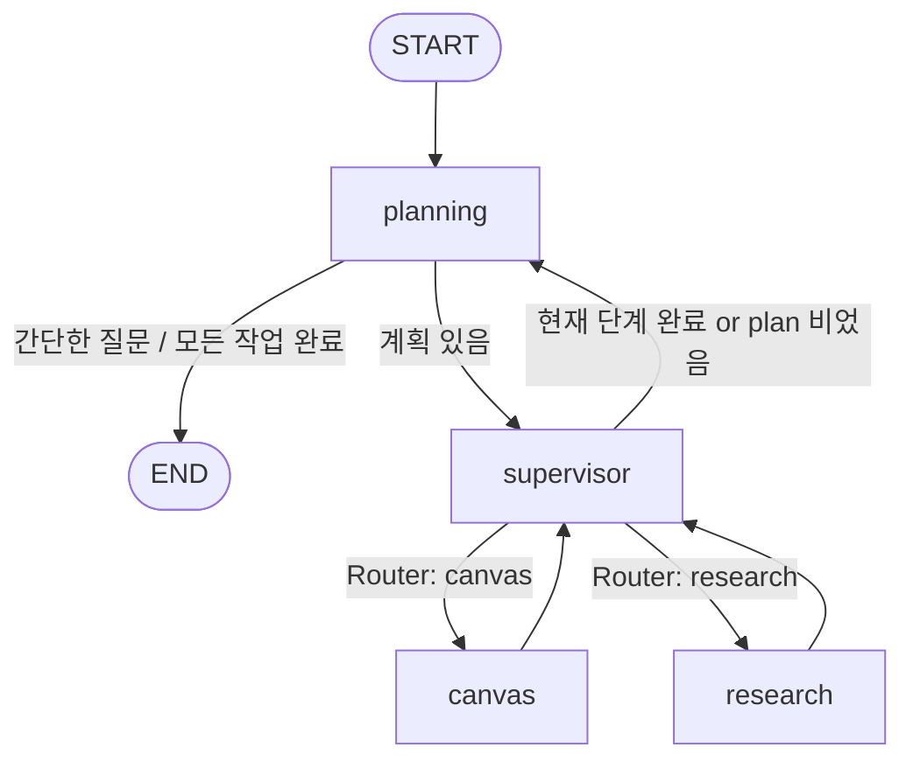

# Supervisor + Planning 멀티 에이전트 정리

이 폴더는 **"계획 세우는 에이전트(Planning)" + "일을 나눠주는 에이전트(Supervisor)" + "실제로 일하는 에이전트 2개(Research, Canvas)"** 로 구성된 LangGraph 멀티 에이전트 예제입니다.

예: "2025 패션 트렌드 조사해서 보고서로 저장해줘" 라고 하면

1. **planning**이 단계별 계획을 세우고
2. **supervisor**가 계획의 첫 단계를 보고 누구에게 시킬지 정하고
3. **research**(웹 검색) 또는 **canvas**(글쓰기/파일 저장)가 실제 작업을 하고
4. 끝나면 다시 **planning**으로 돌아가 남은 계획을 다시 짜는 것을 반복하다가
5. 다 끝나면 최종 답변을 하고 종료합니다.

---

## 1. 파일 구성

| 파일 | 역할 | 한 줄 요약 |
|---|---|---|
| [settings.py](settings.py) | 공통 설정 | LLM 모델(`gpt-4o`)과 State(상태) 정의 |
| [make_graph.py](make_graph.py) | 그래프 조립 | 노드 4개를 등록하고 `START → planning` 연결 |
| [planning_agent.py](planning_agent.py) | 계획 담당 | 계획 수립 / 재계획 / 최종 답변 후 종료 |
| [supervisor_agent.py](supervisor_agent.py) | 관리자 | 현재 단계(`plan[0]`)를 누구에게 맡길지 결정, 완료 판단 |
| [research_agent.py](research_agent.py) | 일꾼 1 | Tavily로 웹 검색 |
| [canvas_agent.py](canvas_agent.py) | 일꾼 2 | 목차 작성 → 본문 작성 → `.md` 파일 저장 |

실행 진입점은 상위 프로젝트의 [langgraph.json](../../../langgraph.json) 입니다.

```json
"graphs": { "rag_agent": "./src/ex_1009/supervisor_planning_agent/make_graph.py:graph" }
```

→ `langgraph dev` 를 실행하면 `make_graph.py` 안의 `graph` 변수를 불러와서 LangGraph Studio에서 돌립니다. (`.env` 에 `OPENAI_API_KEY`, `TAVILY_API_KEY` 필요)

---

## 2. 전체 흐름도



핵심 포인트: **엣지(add_edge)는 `START → planning` 하나뿐**입니다.
나머지 이동은 전부 각 노드가 `Command(goto=...)` 로 **스스로 다음 노드를 정합니다.**

---

## 3. settings.py — 상태(State)와 모델

```python
def get_model():
    return ChatOpenAI(model="gpt-4o")

class State(MessagesState):          # 그래프 전체 상태
    plan: List[str]                  # 남은 작업 목록 (plan[0] = 지금 할 일)
    past_steps: List[tuple]          # 끝낸 작업 기록 [(작업, 결과), ...]

class SupervisorState(MessagesState): # supervisor 노드용 상태
    plan: List[str]
    next: str                        # 다음에 보낼 에이전트 이름
    past_steps: List[tuple]
```

- `MessagesState` 를 상속했으므로 기본으로 `messages` 필드가 있고, **`add_messages` 리듀서**가 붙어 있습니다.
  → 노드가 `{"messages": [...]}` 를 반환하면 **덮어쓰기가 아니라 뒤에 추가**됩니다. (같은 id 메시지는 교체)
- `plan`, `past_steps`, `next` 는 리듀서가 없으므로 **반환한 값으로 통째로 덮어쓰기** 됩니다.
  → 그래서 supervisor는 `past_steps + [새 항목]` 처럼 직접 이어 붙여서 반환합니다.
- `SupervisorState` 의 `next` 는 `State` 에 없지만, LangGraph는 노드 함수의 타입 힌트에 쓰인 스키마의 키도 그래프 채널로 등록하기 때문에 문제없이 저장됩니다.

---

## 4. make_graph.py — 그래프 조립

```python
graph_builder = StateGraph(State, input_schema=MessagesState, output_schema=State)

graph_builder.add_node("planning",   planning_node,   destinations=["supervisor", END])
graph_builder.add_node("supervisor", supervisor_node, destinations=["canvas", "research", "planning"])
graph_builder.add_node("canvas",     canvas_node,     destinations=["supervisor"])
graph_builder.add_node("research",   research_node,   destinations=["supervisor"])

graph_builder.add_edge(START, "planning")
graph = graph_builder.compile()
```

| 설정 | 의미 |
|---|---|
| `input_schema=MessagesState` | 사용자는 `messages` 만 넣으면 됨 (plan 등은 입력 안 받음) |
| `output_schema=State` | 결과로 messages + plan + past_steps 를 돌려줌 |
| `destinations=[...]` | `Command(goto=...)` 로 갈 수 있는 곳을 **그래프 그림(시각화)에 표시**하기 위한 정보. 실제 이동은 Command가 결정 |

---

## 5. planning_agent.py — 계획 세우기 & 재계획

### 5-1. 출력 스키마 (구조화 출력)

```python
class Plan(BaseModel):                 steps: List[str]   # 단계 목록
class ConversationalResponse(BaseModel): response: str    # 바로 답변
class PlanningResponse(BaseModel):
    final_output: Union[Plan, ConversationalResponse]
```

`llm.with_structured_output(PlanningResponse)` 를 쓰면 LLM이 **둘 중 하나의 형태로만** 답하게 강제됩니다.
→ `isinstance(result.final_output, ConversationalResponse)` 로 어느 쪽인지 분기.

### 5-2. 동작은 `plan` 이 비어있는지로 두 갈래

**(A) 처음 들어왔을 때 (`plan` 비어 있음) — 계획 수립**

```
사용자 메시지 → planner(LLM)
   ├─ ConversationalResponse → AIMessage(답변) 추가 → END   (예: "안녕?")
   └─ Plan(steps 2~5개)      → plan 저장 + "작업 계획을 수립했습니다" 메시지 → supervisor
```

**(B) 작업 하나 끝나고 돌아왔을 때 (`plan` 있음) — 재계획(replan)**

replanner 프롬프트에 넣는 정보:

- `input` : `messages[0].content` → 사용자의 **원래 요청**
- `plan` : 현재 계획 목록
- `past_steps` : 지금까지 끝낸 작업과 결과

```
replanner(LLM)
   ├─ ConversationalResponse → 최종 답변 메시지 → END
   └─ Plan(남은 작업만)      → plan을 남은 작업으로 교체 → supervisor
```

> **중요:** plan에서 완료된 항목을 지우는 코드는 따로 없습니다.
> **replanner LLM이 "이미 완료된 작업은 빼고" 새 plan을 만들어 주는 방식**으로 진행이 됩니다.
> 그래서 새 plan의 `[0]` 번이 곧 다음에 할 일이 됩니다.

---

## 6. supervisor_agent.py — 누구에게 시킬까?

```python
class Router(TypedDict):
    """작업을 수행할 에이전트를 라우팅합니다."""
    next: Literal["canvas", "research"]
```

`Router` 를 **도구(tool)로** LLM에 바인딩합니다: `llm.bind_tools([Router])`

### 동작 순서

1. `task_description = plan[0]` — 지금 처리할 단계 하나만 봄
   - plan이 비어 있으면 (`IndexError`) → 바로 `planning` 으로 돌려보냄
2. 최근 메시지 3개(`messages[-3:]`)를 문자열로 만들어 프롬프트에 넣음
3. LLM에게 질문: "현재 작업을 누가 할까? 이미 끝났으면 에이전트 부르지 말고 planning으로"
4. 결과 분기

| LLM 응답 | 의미 | 처리 |
|---|---|---|
| **tool_call 있음** (`Router` 호출) | 아직 안 끝남 → 일꾼 필요 | `HumanMessage("작업을 수행해주세요: {작업}")` 추가 후 `canvas` 또는 `research` 로 이동 |
| **tool_call 없음** | 현재 단계 완료됐다고 판단 | 가장 최근 `canvas_agent`/`research_agent` 메시지를 결과로 삼아 `past_steps` 에 `(작업, 결과)` 추가, 완료 메시지 남기고 `planning` 으로 이동 |

> 즉, **"도구를 호출하느냐 마느냐"로 '일 시키기'와 '완료 처리'를 구분**하는 게 이 코드의 핵심 아이디어입니다.

---

## 7. research_agent.py — 웹 검색 일꾼

```python
tavily_search = TavilySearch(max_results=3)
agent = create_agent(get_model(), [tavily_search], system_prompt="...연구 전문가...")

def research_node(state):
    result = agent.invoke(state)                    # 전체 state(메시지 포함)를 넘김
    result["messages"][-1].name = "research_agent"  # 마지막 답변에 이름표 붙이기
    return Command(goto="supervisor", update={"messages": result["messages"]})
```

- `create_agent` 는 내부적으로 **ReAct 루프**(LLM → 도구 호출 → 결과 보고 → 다시 LLM …)를 돕니다.
- 마지막 메시지에 `name="research_agent"` 를 붙이는 이유:
  - supervisor가 "누가 무슨 결과를 냈는지" 판단할 때
  - canvas가 "조사 결과"를 찾아 쓸 때
  이 **이름표로 메시지를 구분**하기 때문입니다.
- `result["messages"]` 에는 기존 메시지도 포함되어 있지만, `add_messages` 리듀서가 id로 중복을 처리하므로 새로 생긴 메시지들만 실질적으로 추가됩니다.

---

## 8. canvas_agent.py — 글쓰기 일꾼

### 도구 3개 (`@tool`)

| 도구 | 하는 일 |
|---|---|
| `create_outline_from_research(topic, research_results)` | 조사 내용 기반 **목차** 생성 (내부에서 LLM 한 번 더 호출) |
| `write_content_from_research(outline, research_results, topic)` | 목차에 맞춰 **Markdown 본문** 작성 (출처 링크 포함, 내부 LLM 호출) |
| `save_to_file(filename, content)` | `outputs/파일명.md` 로 저장 (확장자 없으면 `.md` 자동 추가) |

- `Annotated[str, "설명"]` 의 설명은 LLM이 **어떤 값을 넣어야 하는지** 알려주는 도구 인자 설명으로 쓰입니다.
- 저장 위치 `outputs` 는 **실행한 현재 디렉터리 기준**입니다. 그래서 `ex_1009/outputs/2025_패션_트렌드_보고서.md` 같은 파일이 생깁니다.

### canvas_node

```python
for msg in messages:
    if msg.name == "research_agent":
        research_results.append(msg.content)     # 조사 결과만 모으기

if research_results:
    enhanced_message = SystemMessage("...이전 작업 결과(Research Agent)...\n위 조사 결과를 바탕으로 글을 작성해주세요.")
    result = agent.invoke({**state, "messages": state["messages"] + [enhanced_message]})
else:
    result = agent.invoke(state)

result["messages"][-1].name = "canvas_agent"
return Command(goto="supervisor", update={"messages": result["messages"]})
```

→ 메시지 히스토리 속에 흩어진 **research 결과를 한 곳에 모아 다시 강조해서** 넘겨주는 것이 포인트입니다.

---

## 9. 실제 실행 예시 따라가기

입력: `"2025년 패션 트렌드를 조사해서 보고서 파일로 저장해줘"`

| 순서 | 노드 | 하는 일 | 상태 변화 |
|---|---|---|---|
| 1 | planning | 계획 수립 | `plan = ["2025 패션 트렌드 자료 조사", "목차·본문 작성 후 파일 저장"]` |
| 2 | supervisor | plan[0] → Router(`research`) | 메시지 "작업을 수행해주세요: 2025 패션 트렌드 자료 조사" |
| 3 | research | Tavily 검색 후 요약 | `research_agent` 메시지 추가 |
| 4 | supervisor | 최근 메시지 보고 "완료" 판단 (tool_call 없음) | `past_steps += [(조사, 결과)]` |
| 5 | planning | replan: 남은 작업만 | `plan = ["목차·본문 작성 후 파일 저장"]` |
| 6 | supervisor | plan[0] → Router(`canvas`) | |
| 7 | canvas | 목차 → 본문 → `save_to_file` | `outputs/2025_패션_트렌드_보고서.md` 생성 |
| 8 | supervisor | 완료 판단 | `past_steps` 2개 |
| 9 | planning | 모두 완료 → `ConversationalResponse` | 최종 답변 후 **END** |

---

## 10. 공부할 때 짚어볼 개념

1. **`Command(goto=..., update=...)`**
   한 번에 "상태 업데이트 + 다음 노드 이동"을 함. 조건부 엣지(`add_conditional_edges`) 없이 노드 안에서 라우팅.
2. **Plan-and-Execute 패턴**
   Planner가 계획 → Executor(여기선 supervisor+일꾼)가 한 단계 실행 → Replanner가 남은 계획 갱신. 이 루프를 반복.
3. **Supervisor 패턴**
   관리자 LLM이 `Router` 도구로 일꾼을 고름. tool_call 유무로 완료 판단.
4. **구조화 출력 (`with_structured_output`) + `Union`**
   LLM 응답 형태를 "계획" 또는 "답변" 중 하나로 강제.
5. **메시지 `name` 이름표**
   여러 에이전트가 같은 `messages` 를 공유하므로, 누가 쓴 메시지인지 구분하는 용도.
6. **리듀서 차이**
   `messages` 는 추가(append), `plan`/`past_steps`/`next` 는 덮어쓰기.

---

## 11. 코드에서 주의할 점 (알아두면 좋은 부분)

- **supervisor의 `else` 분기**: `canvas_agent`/`research_agent` 메시지가 하나도 없는데 LLM이 도구를 호출하지 않으면, `supervisor_final_message` 변수가 정의되지 않아 `UnboundLocalError` 가 날 수 있습니다. (루프 전에 기본값을 넣어두면 안전)
- **`recent_messages`**: `HumanMessage` 도 `name` 속성을 갖고 있어서(`None`) `hasattr` 이 항상 True → 사용자 메시지가 `"None: ..."` 으로 찍힙니다. `msg.name or 'user'` 로 바꾸면 의도대로 나옵니다.
- **planning (A)**: `generated_plan` 이 빈 리스트면 아무것도 return 하지 않아 오류가 납니다.
- **replanner의 목표**: `messages[0].content` 를 원래 요청으로 쓰므로, 같은 스레드에서 대화를 이어가면 첫 질문만 목표로 인식합니다.
- **`save_to_file` 메타데이터**: `f"""---생성일시: ... 생성자: Canvas Agent---{content}"""` 에 줄바꿈이 없어서 파일 첫 줄이 본문 제목과 붙어서 저장됩니다.
- **무한 루프 가능성**: supervisor가 계속 "미완료"로 판단하면 같은 에이전트를 반복 호출할 수 있습니다. 설치된 LangGraph 버전의 기본 `recursion_limit` 은 10007로 매우 커서 사실상 막아주지 못합니다. 실행할 때 `config={"recursion_limit": 30}` 처럼 직접 제한을 거는 게 안전합니다.
